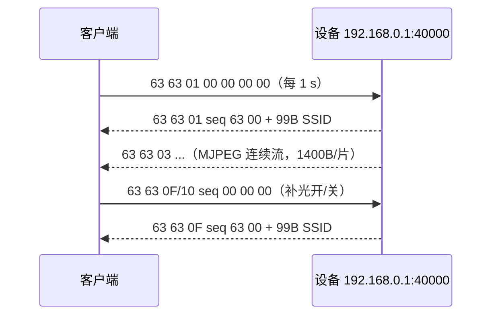

# 采耳镜取景器 · earpick-remote

左点 / UDU 采耳仪（耳镜）的第三方 Android 取景客户端。协议来自对 `com.zdeer.earpick` 1.1.2 的静态逆向与真机抓包：手机加入设备开放热点后，通过 UDP `192.168.0.1:40000` 收 MJPEG、发控制帧。画面只在本机解码，不上传。

## 功能

- 用 `WifiNetworkSpecifier` 申请设备热点，无需定位权限，网络仅对本应用可见
- 1 Hz 心跳注册；UDP 流按 JPEG `SOI/EOI` 切帧，丢包丢弃半帧，支持 16 位序号回绕
- 实时画面 + 帧率 / 带宽 / 电池 ADC 原始值
- 补光灯、镜像、拍照（`Pictures/Earpick`，MediaStore，无需存储权限）
- 双指缩放、双击复位；竖屏底部控制条，横屏右侧控制栏
- Android 17 `ACCESS_LOCAL_NETWORK` 运行时权限适配
- 调试构建可直连任意 UDP 端点，配合 `tools/fake_device.py` 无硬件联调

## 2026 工具链

| 项   | 版本 / 选择                                                                   |
| ---- | ----------------------------------------------------------------------------- |
| 构建 | AGP 9.5.1，Gradle 9.6.1，Gradle 内置 Kotlin（显式 KGP 2.4.21）                |
| SDK  | `compileSdk` / `targetSdk` 37，`minSdk` 29                                    |
| UI   | Jetpack Compose BOM 2026.09.00，Material 3，edge-to-edge                      |
| 架构 | 单 Activity + Compose，ViewModel + StateFlow，构造器注入                      |
| 依赖 | lifecycle 2.11.0、activity-compose 1.13.0、DataStore 1.3.0、coroutines 1.11.0 |
| 测试 | JUnit 6（Jupiter）JVM 单元测试 + 真实 loopback UDP 集成测试                   |
| 发布 | R8 minify + resource shrink                                                   |

构建脚本遵循 AGP 9 的内置 Kotlin：模块里**不应用** `org.jetbrains.kotlin.android`，只保留 Compose 编译器插件；Kotlin 版本在根 `buildscript` 的 classpath 中覆盖。

## 协议速查



通用头 7 字节：`u16 magic=0x6363`、`u8 type`、`u16 seq`、`u16 total length`。

视频包（type `0x03`，54 字节头）：

| 偏移        | 含义                         |
| ----------- | ---------------------------- |
| `0x30`      | 帧内序号                     |
| `0x32`      | 序号 + 1（**不是**分片总数） |
| `0x34`      | 本片负载长度（≤1400）        |
| `0x10`      | 电池 ADC 原始值（实测 73）   |
| `0x1C/0x1E` | 宽 / 高（640×480）           |
| `0x36`      | JPEG 字节                    |

控制帧：`63 63 <cmd> <seq-le> 00 00`。`0x0F` 补光开、`0x10` 补光关、`0x05` 镜像、`0x02` 停流。必须持续发心跳，否则设备不推流。

## 代码结构

```
app/src/main/java/moe/hexzii/earpick/
├── protocol/       纯 JVM：包编解码、MJPEG 重组（可单测）
├── link/           传输接缝、会话循环、Wi-Fi 热点申请
├── data/           DataStore 设置
├── capture/        MediaStore 快照
├── ui/             Compose UI、ViewModel、主题、设置面板
└── EarpickApp.kt   手写依赖容器
```

`EarpickSession` 不依赖 Android：心跳、收包、切帧、统计在单一 IO 循环里，补光/镜像命令经 `Channel` 交给独立 IO actor 发送，主线程从不直接碰 socket；解码与渲染在 Compose 侧通过 conflated `SharedFlow` 消费，解码慢时丢帧而不是阻塞 UDP。

## 构建与测试

```bash
./gradlew :app:assembleDebug          # app/build/outputs/apk/debug/app-debug.apk
./gradlew :app:testDebugUnitTest      # 协议、重组、会话、真实 UDP 集成测试
./gradlew :app:assembleRelease        # R8 压缩，用调试签名
```

集成测试在 JVM 内绑定 loopback UDP，模拟设备按真机格式切片发送一张真实 JPEG，并用 `ImageIO` 校验重组结果，不依赖模拟器。

安装：

```bash
adb install -r app/build/outputs/apk/debug/app-debug.apk
```

## 真机使用

1. 打开采耳仪电源，手机打开本应用。
2. 点「连接设备热点」，在系统弹窗中确认 `zdeer earpick-*`。
3. Android 17+ 首次会请求「附近的设备」权限（本地网络）。
4. 设备应答心跳后自动出图。找不到热点时，在设置里把 SSID 前缀改为 `UDU`（UDU 品牌设备）。
5. 如果设备有回包但没有视频，先强制停止官方 App/其他客户端并重启采耳仪：该固件可能只向先注册的客户端推流。

设备热点是**开放网络**，附近的人也能接入并收到同一路画面；这是固件限制，客户端只能提示，无法修复。

## 无硬件联调

调试构建（`applicationId` 带 `.debug`）的设置里有「开发者 → 直连自定义目标」：

```bash
python3 tools/fake_device.py           # 0.0.0.0:40000，默认发送 tools/testcard.jpg
# 手机与电脑同一 Wi-Fi：主机填电脑局域网 IP
# 模拟器：主机填 10.0.2.2
```

脚本按真机格式回复心跳、20 fps 分片推流，并打印收到的补光/镜像/停流指令。

调试构建也可以直接从命令行指定端点，跳过设置页：

```bash
adb shell am start -n moe.hexzii.earpick.debug/moe.hexzii.earpick.MainActivity \
  --es moe.hexzii.earpick.dev_host 192.168.1.9 \
  --ei moe.hexzii.earpick.dev_port 40000
```

等待页会显示 `接收 / 视频 / JPEG / 缓冲 / 解码失败` 计数：

- 接收 0：报文没进应用，优先查网络绑定/VPN/热点。
- 有接收、无视频：报文类型或端口不对。
- 有视频、无 JPEG：分帧字段/丢包处理有问题。
- 有 JPEG、解码失败：JPEG 格式或解码器问题。

## 权限

| 权限                   | 用途                                   |
| ---------------------- | -------------------------------------- |
| `INTERNET`             | UDP 套接字                             |
| `ACCESS_NETWORK_STATE` | 申请并绑定 app 级 Wi-Fi 网络           |
| `ACCESS_LOCAL_NETWORK` | Android 17+ 访问局域网设备，运行时授予 |

不申请定位、存储、相机或联网上传权限。快照写入 `MediaStore` 的 `Pictures/Earpick`。热点由系统弹窗授权，连接仅限本应用；断开或退出时释放网络请求。

若要上架 Google Play，广域局域网访问需要在 Play Console 做 LAN 访问声明（2027-08-25 起强制）；本项目定位为个人互操作工具。

## 已知限制

- `0x05` 镜像只有切换指令，设备不回传实际状态，UI 为乐观状态。
- 电池只有 ADC 原始值，换算公式未知，因此显示 `ADC n`。
- 仅拍照，不录音/录像；未实现多客户端或自动重连策略（心跳会持续尝试，重试按钮重建会话）。
- 实测固件为 640×480 baseline JPEG；其他分辨率按包头字段显示，未验证。
- 按当前机器资源约束未启动模拟器，也未连接真机：Compose 界面只做了编译与 Preview 校验，`WifiNetworkSpecifier` 系统弹窗与 `ACCESS_LOCAL_NETWORK` 授权流程需要在真机上确认。
