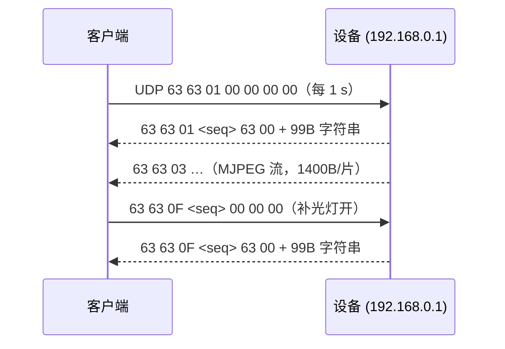

# 左点采耳仪（com.zdeer.earpick）逆向与第三方客户端可行性报告

- 日期：2026-11-02
- 对象：左点健康 `com.zdeer.earpick` 1.1.2（versionCode 14），配套设备 SSID `zdeer earpick-3593`
- 方法：APK 静态逆向 + 真机流量实测 + 客户端原型验证
- 结论级别：协议已可独立实现；少量字段语义仍未知

---

## 1. 结论摘要

1. **链路只有一条**：手机加入设备的开放热点 → 向 `192.168.0.1:40000` 发 UDP 心跳 → 设备向该客户端端口回推 **MJPEG 连续字节流** → 客户端按 JPEG 的 `FFD8…FFD9` 切帧显示。
2. **无鉴权、无加密、无云端**。安全边界只有一个开放热点；同一热点内任何人都能接收画面。
3. **官方 App 1.1.2 的自动入网逻辑与现行固件不匹配**：代码找 `UDU` 前缀 + 固定密码 `XXX`，实际 SSID 是 `zdeer earpick-*` 且无密码。
4. **视频分帧模型与 APK 反汇编不一致**：固件发的是按 1400 字节切片的连续流，不是“每帧 N 片、收满即完成”。帧边界只能靠 JPEG 标记判断（详见 §6 勘误）。
5. **第三方客户端可行且已交付原型**：Go 单文件，UDP 收流 + 本地 MJPEG 网页，实测 20 fps / 409 KB/s，见 §8。

---

## 2. 材料与方法

### 2.1 安装包

| 项           | 值                                                                                         |
| ------------ | ------------------------------------------------------------------------------------------ |
| 包名 / 名称  | `com.zdeer.earpick` / 左点健康                                                             |
| 版本         | 1.1.2（versionCode 14）                                                                    |
| 大小         | 39,651,925 B                                                                               |
| 来源         | 应用宝 appid 54238603；CDN `imtt.dd.qq.com/16891/apk/1BD2473A5DBCB5061964241A23301564.apk` |
| MD5          | `1bd2473a5dbcb5061964241a23301564`（与商店元数据一致）                                     |
| SHA-256      | `615585c011f0e5cefcd7ca50109b0b42c45b4ed460c7a9e32dc48887e71a6d32`                         |
| 签名         | V2，`CN=Android Debug`，证书 SHA-256 `3d34babf…845a2`                                      |
| SDK / ABI    | minSdk 23 / targetSdk 30；arm64-v8a + armeabi-v7a                                          |
| 设备安装状态 | 分析期间未安装（`pm list packages` 无结果）                                                |

### 2.2 设备与主机

- 设备热点：`zdeer earpick-3593`，BSSID `10:72:31:00:35:93`，ch7 / 2442 MHz，`[ESS]` 开放网络。
- 手机（测试端）：加入热点后 `192.168.0.101/24`，网关 `192.168.0.1` 可达（ping 7–27 ms）。
- 主机：macOS arm64，全程保持在原网络 `192.168.1.10` 未断网；测试通过手机 USB + adb 完成。

### 2.3 工具链

- 静态：`aapt2`、`dexdump`（Dalvik 反汇编）、`llvm-objdump`（AArch64）、`apksigner`、`strings`。
- 动态：自研 Go 探针（交叉编译 `GOOS=linux GOARCH=arm64` 静态二进制，adb 推送到 `/data/local/tmp` 运行）。
- 抓包：客户端侧原始 UDP 落盘（无需 root），离线用 Python 解析。

---

## 3. 静态分析

### 3.1 应用结构

| 层       | 内容                                                                                                                                            | 证据          |
| -------- | ----------------------------------------------------------------------------------------------------------------------------------------------- | ------------- |
| Dart AOT | `libapp.so`，`package:udu/...`（`earpick_play_page.dart`、`common/utils/wifi.dart`、`app_controller.dart`）                                     | 字符串表      |
| Java 桥  | `com.lewei.udu.MainActivity`（通道 `flutter.io/udu`）；`MyPlatformView`（通道 `flutter.io/udu/MyPlatformViewMethodChannel`，注册名 `testView`） | `classes.dex` |
| 原生 SDK | `liblewei-3.0.so`，JNI 类 `com.lewei.lib.LeweiLib23` / `LWAPIManeger`                                                                           | 导出符号      |

只用到 7 个 JNI 方法：`nativeInitStream`、`nativeGetMJPEGFrame`、`nativeLedON`、`nativeLedOFF`、`nativeSetMirror`、`nativeDeInitStream`、`getAdcSta`。

### 3.2 通道方法

- `flutter.io/udu`：`setType`、`isWifiEnable`、`setNetwork`、`disconnectWifi`、`openWifi`、`setLed`、`isLocServiceEnable`、`getConnectStatus`、`getWifiName`、`getBatteryValue`、`getChargeStatus`。
- `flutter.io/udu/MyPlatformViewMethodChannel`：`getView`、`startPreview`、`setScale`、`takePicture`、`startRecord`、`disConectWifi`、`dispose`。
- Dart 侧实际调用（字符串表）：`getConnectStatus`、`getWifiName`、`getBatteryValue`、`getChargeStatus`、`isLocServiceEnable`、`setLed`、`setType`、`startPreview`、`startRecord`、`takePicture`。

### 3.3 静态发现的关键代码路径

- `MainActivity.onCreate` → `LWAPIManeger.init()` → 线程循环 `LeweiLib23.initStream(cb, 0)`。
- `nativeInitStream`（`liblewei` @0x207C4）：端口 = 参数 + `0x9000` + `0xC40` = **40000**，写入全局 `0xBC6F8`；启动 `vga_read_buffer_thread`（0x1FD98）与 `vga_send_command_thread`（0x1F9E4）。
- `vga_create_udp`（0x1F87C）：`socket(AF_INET, SOCK_DGRAM)`，目标 `inet_addr("192.168.0.1")`（字符串 @0x81DF0）、`htons(40000)`，仅设 500 ms 超时，不 bind/不 connect。
- 命令队列：`nativeLedON` 写 cmd `0x0F`、`nativeLedOFF` 写 `0x10`、`nativeSetMirror` 写 `0x05`、WiFi 信道写 `0x06`（72 字节配置包）。
- 旧 App 的接收逻辑：`u16@0x30` 当分片序号、`u16@0x32` 当总片数、`u16@0x34` 当负载长度，收满 `total` 完成一帧（**与实测固件不符，见 §6**）。

### 3.4 权限与行为

- 权限：`INTERNET`、`CHANGE_WIFI_MULTICAST_STATE`、`ACCESS/CHANGE_WIFI_STATE`、`ACCESS/CHANGE_NETWORK_STATE`、`WAKE_LOCK`、`WRITE_SETTINGS`、`WRITE_EXTERNAL_STORAGE`、`CAMERA`、`RECORD_AUDIO` 等。
- **未声明任何定位权限**（但 UI/帮助文案要求开启定位）。
- 未声明 `debuggable`、无 USB host/accessory 特性与过滤器、无 `adb_enabled`/`WRITE_SECURE_SETTINGS` 引用。
- `UsbManager` 仅在 AndroidX `ContextCompat` 的服务名映射表中出现，无实际 USB I/O。
- `ProcessBuilder` 仅出现在友盟 SDK 读取 CPU 频率的代码中。

### 3.5 背景：UDU 与 zdeer 的关系

- `UDU` 是方案商的白牌 App 家族：Google Play `com.lewei.udu006`（UDU Pro 可视黑头仪）、App Store「UDU Beauty」、国内「UDU + 杰斯通黑头仪」。
- `zdeer` 是左点品牌；`com.zdeer.earpick` 在该基座上贴牌，残留 `com.lewei.udu`、`flutter.io/udu`、`UDU Beauty-6a5a`。
- 因此 App 的 SSID 匹配/固定密码是基座遗留，固件已改为品牌名与开放网络。

---

## 4. 真机实测

### 4.1 入网

```
adb shell cmd wifi connect-network '"zdeer earpick-3593"' open
→ 192.168.0.101/24，网关 192.168.0.1，ping 7–27 ms
```

### 4.2 心跳是“注册”，不是可选

| 实验                            | 结果               |
| ------------------------------- | ------------------ |
| 静默监听 4 s                    | **0 个包**         |
| 发送一次 `63 63 01 00 00 00 00` | 立即回包并开始推流 |

回包：106 字节 = 7 字节头 + 99 字节 SSID 字符串。

```
63 63 01 <seq16> 63 00 7a 64 65 65 72 20 65 61 72 70 69 63 6b 2d 33 35 39 33 00 …
```

### 4.3 视频

- 抓包样本：400 个 `0x03` 包 / 561,156 字节（约 4 s），序号 1–409，存在 16→25 的缺口（丢包）。
- 每包：头 54 字节 + 负载 ≤1400 字节；满载包长 1454。
- 400 包中检出 26 个 JPEG SOI；重组出标准 **640×480 baseline JPEG**（首张 20,159 字节）。
- 吞吐约 **278–333 包/秒 ≈ 390 KB/s**，估算 **18–20 fps**。

### 4.4 控制

| 命令     | 线上字节                    | 设备响应                  |
| -------- | --------------------------- | ------------------------- |
| 补光灯开 | `63 63 0f <seq16> 00 00 00` | 回 `63 63 0f …`，106 字节 |
| 补光灯关 | `63 63 10 <seq16> 00 00 00` | 回 `63 63 10 …`，106 字节 |

嘉奖/停止：`0x02`（未在本次实测中观察回包）。命令有 ACK，但回包序号是设备自己的计数器。

### 4.5 USB

- 采耳仪插入 USB 后**零枚举**（无 VID/PID、无串口、无 UVC、无 ADB 接口），仅端口供电；App 也无 USB 代码路径。
- 手机插入时枚举为 `18d1/4e11/0601` 复合设备（ADB + PTP），即当时手机 USB 调试开启且已授权。
- 测试结束后手机已恢复原网络 `CU_AfQU_5G`（192.168.1.6）。

---

## 5. 协议规范（实现用）

### 5.1 会话时序



### 5.2 通用头

| 偏移  | 类型 | 含义                                                                              |
| ----- | ---- | --------------------------------------------------------------------------------- |
| 0x00  | u16  | 魔数 `0x6363`（线上 `63 63`）                                                     |
| 0x02  | u8   | 类型：`0x01` 心跳/上报，`0x03` 视频，`0x05` 镜像，`0x0F/0x10` 补光灯，`0x02` 停流 |
| 0x03  | u16  | 包序号（16 位回绕）                                                               |
| 0x05  | u16  | 本包总长（视频满载 1454）                                                         |
| 0x06… | —    | 类型相关字段                                                                      |

### 5.3 视频包（类型 0x03）

| 偏移 | 类型  | 实测含义                       |
| ---- | ----- | ------------------------------ |
| 0x07 | u8    | 固定 `0x03`                    |
| 0x08 | u32   | 恒 0（未使用）                 |
| 0x0C | u32   | **本帧内**累计结束偏移（每帧重置，首包 1400） |
| 0x10 | u32   | 电量/ADC 原始值（实测恒 73）   |
| 0x1C | u16   | 宽（0x0280 = 640）             |
| 0x1E | u16   | 高（0x01E0 = 480）             |
| 0x30 | u16   | 帧内序号                       |
| 0x32 | u16   | 帧内序号 + 1（**不是总片数**） |
| 0x34 | u16   | 本片负载长度（≤1400）          |
| 0x36 | bytes | JPEG 数据                      |

### 5.4 分帧算法（伪代码）

```text
on packet(type=3):
    if frame_index == 1:                       # 新帧
        drop partial buffer
    elif offset != last_offset + payload_len:  # 0x0C 跳变 = 真丢包
        drop partial buffer
    last_offset = offset

    append payload to buffer                   # 0x36..0x36+payload_len
    loop:
        s = index(buffer, FFD8)
        if s < 0: keep last byte; break
        buffer = buffer[s:]
        e = index(buffer, FFD9)
        if e < 0: break
        emit JPEG(buffer[:e+2])
        buffer = buffer[e+2:]
```

> 若固件把 `0x0C` 置 0，则退化为按 16 位包序号 `seq+1` 判断丢包。

### 5.5 控制命令

`63 63 <cmd> <seq16> 00 00`（7 字节）；`0x0F` 补光灯开、`0x10` 关、`0x05` 镜像、`0x02` 停流。
`0x06/0x07` 为 72 字节配置包（未实测）。

### 5.6 兼容性要点

- 必须每秒发心跳；否则设备不推流。
- 必须容忍序号回绕（16 位）与丢包。
- SSID 匹配应覆盖 `zdeer earpick*` 与 `UDU*`，并检测开放/WPA。
- 不要依赖 `u16@0x32` 作为总片数。

---

## 6. 勘误：早期结论 vs 实测

| 早期说法（来自 APK 反汇编）                            | 实测结果                            | 状态        |
| ------------------------------------------------------ | ----------------------------------- | ----------- |
| SSID 含 `UDU`、密码 `XXX`                              | 实际 `zdeer earpick-3593`，开放网络 | ❌ 代码遗留 |
| 分片序号 + 总片数，收满完成                            | `0x32` 是序号+1；帧边界靠 SOI/EOI   | ❌          |
| `0x0C` = 整帧字节数                                    | 本帧内累计结束偏移（每帧重置）      | ❌          |
| `0x08` = 帧 ID                                         | 恒 0                                | ❌          |
| `0x0081` 心跳标志可能是推流开关                        | 全零心跳即可出流                    | ⚠️ 非必需   |
| 电量=ADC 原始值                                        | 值 73 观测一致，换算未知            | ⚠️ 推断     |
| 端口 40000 / IP 192.168.0.1 / 心跳 1 s / LED 0x0F/0x10 | 全部命中                            | ✅          |

---

## 7. 工具与产物

| 路径                                 | 内容                                  |
| ------------------------------------ | ------------------------------------- |
| `earpick/app.apk`                    | 原始安装包                            |
| `earpick/x/`                         | 解包树（dex、so、assets）             |
| `earpick/captures/raw.bin`           | 400 包原始抓包（长度前缀）            |
| `earpick/captures/frame_640x480.jpg` | 重组出的真实画面                      |
| `earpick/tester/main.go`             | UDP 探针（心跳/收包/重组/落盘）       |
| `earpick/tester/probe/main.go`       | 心跳注册与 LED 回执实验               |
| `earpick/desktop/main.go`            | 桌面客户端（UDP + MJPEG 网页 + 控制） |
| `earpick/desktop/fake_device.py`     | 无硬件联调用的假设备                  |

复现：

```bash
# 手机加入设备热点后
adb push earpick_test /data/local/tmp/ && adb shell /data/local/tmp/earpick_test 192.168.0.1:40000 dump
# 桌面客户端（电脑需在设备热点内）
cd earpick/desktop && ./zdeer-client && open http://127.0.0.1:8080
```

---

## 8. 客户端方案与已实现原型

| 方案                       | 产物            | 评价                            |
| -------------------------- | --------------- | ------------------------------- |
| **Go + 本地网页（MJPEG）** | 单二进制 5.6 MB | ✅ 已实现，零依赖，三端交叉编译 |
| Python + 网页              | 脚本            | 最快写，但分发需解释器          |
| Go + Wails / Tauri         | 原生窗口        | 需要独立窗口时再加壳            |
| Fyne / Gio                 | 单二进制        | 纯 Go GUI，工作量更大           |
| Electron / Qt              | 100 MB+         | 本场景不必要                    |

已实现：心跳、序号拼接、SOI/EOI 切帧、丢包丢弃半帧、`/stream` MJPEG、`/snapshot`、`/status`、补光灯/镜像命令。
联调：假设备 20 fps / 409 KB/s，页面与截图均正常。

---

## 9. 安全、合规与风险

- 设备热点**无密码**：同场所任何人可接入并接收耳道画面；这是产品设计问题，客户端无法修复，应至少提示用户。
- 协议**无鉴权**：不要把它扩展成“远程控制他人设备”的服务。
- 逆向目的为互操作；不随客户端分发官方 APK、资源、原生库或抓包。
- 医疗/隐私场景：图像属敏感数据，客户端应默认只存本地、不上传。
- `CN=Android Debug` 签名仅说明该安装包使用调试证书，不构成篡改证据。

---

## 10. 未解决问题与后续计划

| 优先级 | 问题                                             | 建议验证方式                                            |
| ------ | ------------------------------------------------ | ------------------------------------------------------- |
| P0     | `u16@0x32` 的语义（固件差异还是官方 App 不兼容） | 用官方 App 连接同一台设备看是否出图；再抓另一台设备对比 |
| P0     | 设备是否支持多客户端                             | 同时开两个 socket 收流                                  |
| P1     | 电量 73 的换算与充电位                           | 对照官方 App 显示 + 放电过程取样                        |
| P1     | `0x06/0x07` 配置命令的作用                       | 谨慎试探（可能改 WiFi 名/密码）                         |
| P2     | 丢包/乱序恢复策略                                | 人为丢包，观察设备是否重传                              |
| P2     | USB 零枚举是设备还是线材                         | 换数据线复测                                            |
| P3     | UDU 家族其他设备（黑头仪）是否共用 0x6363 协议   | 找一台同方案设备抓包                                    |

---

## 附录 A：证据索引

- 端口计算：`liblewei-3.0.so` `nativeInitStream` @0x207C4（`+0x9000 +0xC40` → 0x9C40=40000，写入 0xBC6F8）。
- IP 字符串：`liblewei-3.0.so` @0x81DF0 `"192.168.0.1"`，被 `vga_create_udp` 与 `open_tcp_socket` 引用。
- UDP 线程：`vga_read_buffer_thread` @0x1FD98；发送线程：`vga_send_command_thread` @0x1F9E4；发送函数 `vga_send_udp` @0x1F9B4。
- 命令装载：`nativeLedON` @0x20ED8（cmd 0x0F）、`nativeLedOFF` @0x20EFC（0x10）、`nativeSetMirror` @0x20DA8（0x05）。
- Java：`MainActivity.gotoConnectOurWifi` @0x3AA36C（SSID `UDU` 过滤、`CreateWifiInfo(ssid,"XXX",1)`）；`MainActivity$1.handleMessage`（what=21 触发自动入网）。
- 画面解码：`LWAPIManager$4` 调 `BitmapFactory.decodeByteArray` @0x3A8E40。

## 附录 B：实测样本

```
心跳回包：63 63 01 9f 07 63 00 "zdeer earpick-3593" 00…
视频包  ：63 63 03 01 00 ae 05 03 | 0x0C=0x578 | 0x10=0x49 | 0x1C=0x0280 | 0x1E=0x01E0
          0x30=1 | 0x32=2 | 0x34=0x578 | 0x36=FF D8 FF E0 00 10 4A 46 49 46…
```

---

## 附录 C：使用现实——热点、断网与设备可达性

> 记录实机联调中与协议无关、但直接决定客户端能否使用的结论。

### C.1 结构性限制

设备只提供自己的 AP，没有外网。手机或电脑加入 `zdeer earpick-*` 后都会暂时失去互联网；同一块 Wi-Fi 网卡不能同时待在设备热点和原网络。

### C.2 实测现象

| 场景                       | 观察                                                     |
| -------------------------- | -------------------------------------------------------- |
| Mac 连上设备热点           | `en0` 拿到 `192.168.0.100/24`                            |
| 切回原网络后               | `192.168.1.10`，默认网关 `192.168.1.1`                   |
| 此时向设备发包             | `write udp ...: sendto: no route to host`                |
| `route -n get 192.168.0.1` | 只匹配默认路由 `192.168.1.1`，没有 `192.168.0.0/24` 直连 |
| 手机在同一热点             | `192.168.0.101/24`，直连可达，收流正常                   |

这不是 macOS 的「智能降级」或防火墙：UDP 发送前内核查路由表，目的网段没有直连路由就只能走默认网关；家用路由器不会转发到另一个私网，返回 ICMP unreachable，`sendto` 报 `EHOSTUNREACH`。macOS 通常不会像 Android 那样静默切回有外网的热点；当时是机器已经回到 CU 网络。

### C.3 平台差异

| 行为       | Android                                      | macOS                     |
| ---------- | -------------------------------------------- | ------------------------- |
| 路由模型   | 按网络分表，可用 `Network.bindSocket()` 指定 | 单一全局路由表 + 服务顺序 |
| 热点无外网 | 可能主动切回有外网的热点                     | 一般只提示，不静默切走    |
| 多网卡     | socket 可绑定指定 Network                    | 只能靠目标网段所在接口    |

Android 那次能发，是因为热点恰好是默认网络；如果蜂窝是默认且 socket 未绑定 Wi-Fi，同样发不出去。这也是新客户端使用 `Network.bindSocket()` 的原因。

### C.4 可行方案

1. **手机收流 + `adb forward`（已实测）**：手机连热点运行客户端，Mac 留在原网络，用 `adb forward tcp:8080 tcp:8080` 访问；Mac 网络不变。实测 21 fps / 453 KB/s，画面与截图正常。
2. **第二块网卡/以太网/USB 共享网络**：一台机器同时保留互联网和热点。
3. **硬件中继**：中继加入热点，转成 RTSP/WebRTC/MJPEG-over-HTTP，其他设备无需加入热点。

`adb` 方向不要写反：需要的是 `adb forward`（Mac 访问手机），不是 `adb reverse`。

### C.5 现场判定

```bash
route -n get 192.168.0.1
# 直连：interface: en0，且没有 gateway 行
# 走错：gateway: 192.168.1.1

arp -an | grep 192.168.0.1
# 有 MAC = L2 通；incomplete = ARP 不通

ping -c 2 192.168.0.1
```

- 走默认网关 → 其实没连上设备热点。
- 直连但 ARP incomplete → 设备不在线/不在这个 AP。
- 直连且 ping 通 → 客户端一定能发出去，问题在协议层。

补充：协议目标始终是 `192.168.0.1:40000`；客户端使用随机临时端口，不是本地 40000。

### C.6 结论边界

「macOS 发不出 UDP」并没有在「Mac 确实还在热点上」的时刻验证过；已验证的是「不在设备网段时发不出」。只要直连路由存在且 ARP 正常，macOS 与 Android 一样能发。

---

## 附录 D：品牌与方案商——UDU 与 zdeer

> 补充 §3.5。结论：**zdeer 是品牌，UDU 是方案商/贴牌基座的遗留名，不是两种设备。**

### D.1 证据

| 字符串/线索 | 位置                                                                   | 含义                        |
| ----------- | ---------------------------------------------------------------------- | --------------------------- |
| `zdeer`     | 包名 `com.zdeer.earpick`、武汉左点科技、设备 SSID `zdeer earpick-3593` | 品牌/公司/当前固件命名      |
| `UDU`       | App 内 SSID 过滤、`UDU Beauty-6a5a`、`flutter.io/udu`、`com.lewei.udu` | 方案商项目/贴牌基座命名     |
| `lewei`     | `liblewei-3.0.so`、`com.lewei.lib.LeweiLib23`                          | 底层 WiFi 摄像头 SDK 提供方 |

网络检索也指向同一结论：`com.lewei.udu006`（UDU Pro）是可视黑头仪配套 App，UDU Beauty 描述为 WiFi 图像传输的洁面仪应用；国内资料将 UDU 与杰斯通黑头仪配对。

### D.2 官方 App 为什么连不上

- 1.1.2 的自动入网仍匹配 `UDU` 前缀 + 固定密码 `XXX`。
- 当前固件 SSID 是 `zdeer earpick-*` 且为开放网络。
- 所以自动入网必然失败，只能手动连接；这不代表协议不兼容。

### D.3 对客户端的影响

1. SSID 匹配应覆盖 `zdeer earpick*` 与 `UDU*`，并按扫描结果区分开放/WPA，不能写死 `XXX`。
2. 协议层不随品牌变化：同样的 `63 63`、UDP 40000、MJPEG；第三方客户端不需要按品牌分叉。
3. 老批次设备可能仍广播 `UDU ...`；UDU 品牌同款硬件是否存在、官方新版是否修正匹配逻辑，仍未验证。

### D.4 同类设备不是同一协议

公开的采耳仪逆向项目（UseeEar、Soulear 等）使用不同地址/端口和 `0xffeeffee` 魔数、不同分片模型。`0x6363 + UDP 40000` 这套当时没有公开文档；同族设备是否共用同一 VGA 路径，需要另取一台抓包验证。
